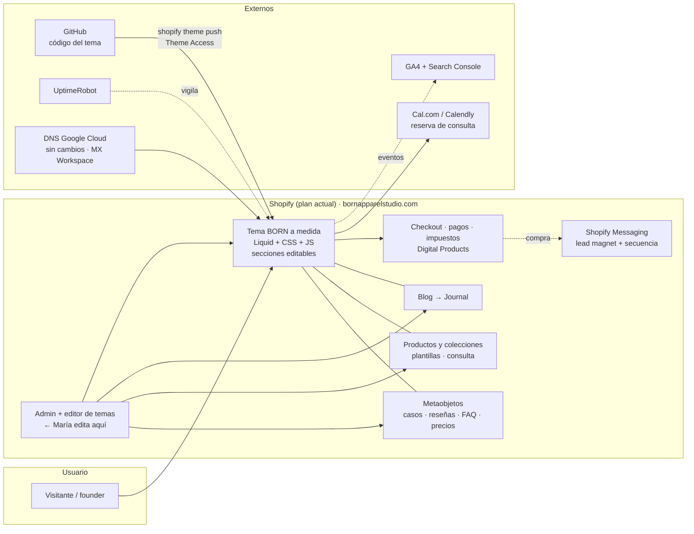

# 09 — Viabilidad técnica, alcance e integración con Shopify

**Born Apparel Studio · Nuevo sitio web · Informe de viabilidad técnica y operativa**
Matisis Consultancy · 5 noviembre 2026 · Previo a cualquier diseño o desarrollo

> **Fuentes.** Documentación oficial consultada el 5 nov 2026 (shopify.com, help.shopify.com, shopify.dev y las páginas de precios y documentación de cada proveedor), con cita y URL en el anexo §13. Las afirmaciones sobre la tienda actual vienen de la observación directa ([01b](01b_auditoria_web_actual.md)). **[C]** confirmado en fuente oficial u observación · **[NC]** no confirmado · **[E]** estimación · **[R]** recomendación.
> **Lo que no se ha podido ver:** el plan de Shopify que paga Born, las apps instaladas, el registrador del dominio y los datos de ventas. Hace falta acceso de colaborador para cerrarlos.

---

## 0. Conclusión anticipada

1. **La recomendación cambia respecto al correo del 2 de noviembre.** Las dos preguntas de María (seguir vendiendo plantillas y lanzar una línea de activewear; editar ella misma la web) y el calendario (primera entrega el 20 nov) apuntan a la misma respuesta: **un tema de Shopify construido a medida, en código, desde cero** (opción A′), no un sitio separado de Shopify.
2. Esa opción cumple tres de las cuatro promesas del correo: *diseño sin límites de plantilla*, *más velocidad* y *captación a medida*. La cuarta, *"el código, el dominio y el alojamiento son tuyos"*, se cumple de otra forma: el código es suyo (en su repositorio) y el dominio también, pero **el alojamiento es Shopify**, que María ya paga. **Hay que explicárselo antes de empezar.**
3. Un sitio *headless* (B) es técnicamente viable, pero **desproporcionado** para 31 productos digitales y un calendario de 15 días. Un sitio estático separado con la tienda en un subdominio (C) es viable, pero añade un CMS, un servicio de formularios, un segundo diseño para la tienda, un cambio de DNS y dos paneles de edición.
4. **La línea de activewear y la marca personal no caben en este proyecto.** Requieren otra tienda, que se factura aparte [C], y otro público.
5. **Claude Code puede desarrollar el tema completo, las secciones editables y el SEO técnico.** No puede crear cuentas, pagar suscripciones, aceptar términos, configurar pagos ni impuestos, ni conceder accesos: eso lo hace una persona.

---

## 1. Diagnóstico de la infraestructura actual

| Componente | Estado | Fuente |
|---|---|---|
| Plataforma | Shopify, tema "Header Copy of Dawn" (Dawn 15.2.0) con JS propio | [C] 01b |
| Tienda | 31 productos (30 sin envío: digitales o servicios; 1 marcado como físico, probablemente por error), 4 colecciones, USD, Guadalajara MX | [C] `/products.json`, `/meta.json` |
| Plan de Shopify | **Desconocido** | [NC] requiere acceso |
| Entrega de descargas | Sin app visible desde el escaparate; probablemente *Shopify Digital Products* (gratuita) | [NC] |
| Pagos | Desconocido; Shopify Payments **sí está disponible en México** | [C] help.shopify.com |
| Dominio y DNS | Apex → 23.227.38.65 (Shopify); `www` → `shops.myshopify.com`; NS en Google Cloud DNS; **correo en Google Workspace** (MX/SPF) | [C] 01b |
| Registrador | Desconocido (si era Google Domains, hoy está en Squarespace Domains) | [NC] |
| Analítica | Solo píxeles nativos de Shopify; sin GA4/GTM/Meta | [C] 01b |
| Reserva | Calendly (llamada gratuita) + producto "consulta" de $120 en Shopify | [C] 01b |
| Contenido | 13 páginas (3 con texto de otra empresa), blog vacío, sin meta descriptions | [C] 01b |
| Rendimiento | Home de ~17.8 MB (vídeo de 165 MB), LCP móvil de 3.7 s (laboratorio) | [C] 01b |

**[I]** El problema de la web actual no es Shopify: es el tema (una copia de Dawn con añadidos), el contenido y un vídeo. Ninguno de los tres exige cambiar de plataforma.

---

## 2. Auditoría del alcance contratado

**Documentos que fijan el alcance:** la propuesta de Canva, abril 2026 ([01 §3.1](01_auditoria_estrategica.md)), y el correo del 2 nov, con el OK de María del 5 nov ([03 §4.1](03_publicos_oportunidades_y_decisiones.md)).

| Funcionalidad / actividad | Origen | Clasificación |
|---|---|---|
| Rediseño UX/UI orientado a conversión, páginas de servicio | Propuesta | **Incluida** |
| Construcción "en código" | Correo 2 nov (sustituye a "sobre Shopify existente") | **Incluida** (cambio aceptado) |
| Captación de leads + lead magnet + secuencia de 4–5 emails | Propuesta ("a definir") | **Incluida, con definición pendiente** |
| Estudio e implementación de keywords SEO | Propuesta | **Incluida** |
| **Dos idiomas** | Propuesta | **Incluida**: hay que resolverla técnicamente y en contenido (¿quién traduce?) |
| Seguir vendiendo plantillas | María, 5 nov | **Necesaria** (continuidad del negocio existente) |
| Edición autónoma por María | María, 5 nov | **Necesaria** para que la web sea operable. No estaba escrita; su coste depende de la arquitectura (§5) |
| Redirecciones 301, analítica base, retirar contenido de terceros | Auditoría | **Necesarias** para cumplir el alcance sin daño |
| Animaciones de marca (wordmark por fases, cinta) | Brandbook | **Mejora recomendable**, dentro de lo razonable |
| Formulario de brief con adjuntos | Estrategia | **Mejora recomendable** (resoluble sin coste, §6) |
| Consulta de pago integrada | Estrategia (D9) | **Sujeta a decisión** de María |
| Tienda de la línea activewear | María, 5 nov | **Fuera de alcance**: requiere aprobación y otra tienda |
| Marca personal de María | María, 5 nov | **Fuera de alcance** |
| Project Room como portal de clientes | Etapa 1 | **Fase posterior** |
| Fotografía, hosting, dominio, publicidad | Propuesta | **Excluidos** (los paga la clienta) |
| Mantenimiento pasados 6 meses | Propuesta | **Excluido**: necesita un acuerdo aparte |

**Riesgo contractual:** el paquete completo (marca + web + redes) se cerró en 2,200 USD y la Etapa 1 ya consumió mucho más de lo que una lectura literal implicaba. **Cualquier pieza que añada sistemas** (un CMS externo, una tienda nueva, un portal) amplía el alcance sin presupuesto. La arquitectura debe minimizar las piezas.

---

## 3. Capacidades y limitaciones de Claude Code

Claude Code es un asistente de desarrollo: escribe, prueba y despliega código con las herramientas y credenciales que se le den. No es un hosting, ni un CMS, ni un comercio electrónico, ni una persona con permisos sobre cuentas ajenas. El trabajo vive en un repositorio git; el contenedor de cada sesión es efímero.

| Capacidad | ¿Directo? | Depende de | Notas |
|---|---|---|---|
| Frontend completo (HTML/CSS/JS, Liquid, Astro, React) | **Sí** | — | Incluye el sistema visual ya construido (tokens en `tools/src/root.css`) |
| Componentes personalizados y **secciones editables** de Shopify | **Sí** | Arquitectura de temas de Shopify | Sections/blocks + schema = editables en el editor de temas [C] |
| Animaciones e interacciones | **Sí** | — | Con `prefers-reduced-motion` y medición de rendimiento |
| Plantillas de producto y colección | **Sí** | Shopify (datos) | Diseño de la página de producto en Liquid o vía API |
| Conectar APIs / integrar Shopify | **Sí** (código) | **Shopify** (tokens, permisos y límites de la API) | Los tokens los genera una persona en el admin |
| Lógica comercial (checkout, pagos, impuestos) | **No** | **Shopify** | El checkout lo aloja Shopify; personalizarlo a fondo es solo para Plus [C] |
| Formularios | **Sí** (front + validación) | Destino: Shopify, servicio de formularios o función serverless | La recepción y el almacenamiento son infraestructura externa |
| Analítica | **Sí** (etiquetado, eventos) | GA4 / app Google & YouTube; cuentas de Google | Crear cuentas y aceptar términos es manual |
| SEO técnico (titles, schema JSON-LD, sitemap, hreflang, alt, rendimiento) | **Sí** | Plataforma (Shopify genera sitemap y robots) | Search Console: verificación manual |
| Herramientas internas, scripts, automatizaciones | **Sí** | Infraestructura donde se ejecuten | Cualquier automatización que corra sola necesita un servidor, una función o Flow |
| Un CMS propio | Técnicamente sí; **no recomendable** | Hosting, autenticación, mantenimiento | Reinventar lo que Shopify o un CMS ya resuelven |
| Pruebas y depuración (Playwright, Lighthouse, validadores) | **Sí** | — | Navegador disponible en el entorno |
| Despliegues | **Sí**, con credencial | Shopify CLI + contraseña de **Theme Access** (`SHOPIFY_CLI_THEME_TOKEN`), o deploy del hosting | La contraseña la genera María desde la app Theme Access; el enlace caduca en 7 días y se ve una sola vez [C] |
| Mantener y actualizar el código | **Sí**, en sesiones futuras | Que exista alguien (Matisis) que las abra | No hay mantenimiento "automático" |

**Clasificación pedida:**
1. **Directo con Claude Code:** tema o frontend, componentes, animaciones, plantillas, SEO técnico, etiquetado de analítica, pruebas, scripts de migración (mapa de redirecciones, exportaciones).
2. **Depende de APIs o servicios de Shopify:** catálogo, carrito, checkout, pagos, impuestos, clientes, pedidos, descargas, emails transaccionales, Flow, metaobjetos.
3. **Necesita infraestructura externa:** hosting fuera de Shopify (solo en B/C), CMS externo (C), recepción de formularios con adjuntos (C), reservas (Calendly / Cal.com), email marketing si no se usa Shopify.
4. **Configuración manual o permisos humanos:** cuentas (Shopify colaborador, Google, Cal.com), Theme Access, DNS, Shopify Payments, Shopify Tax, idiomas/mercados, términos legales, envío de la secuencia de emails, permisos de clientes para casos.
5. **Mantenimiento continuo:** actualizaciones de dependencias (B/C), tokens y claves rotables, cambios de API (Shopify versiona trimestralmente), revisión de formularios y spam, contenido del journal.

---

## 4. Comparativa de arquitecturas

| | **A′ · Tema Shopify a medida** | **B · Headless** | **C · Híbrida: estático + tienda en subdominio** | **D · Estático con Shopify como CMS (metaobjetos)** |
|---|---|---|---|---|
| Qué es | Tema Online Store 2.0 escrito desde cero (no Dawn), en el dominio actual | Frontend propio (Hydrogen/React Router u otro) contra la Storefront API; checkout en Shopify | Web estática (p. ej. Astro) en hosting propio + Shopify con su tema en `shop.` | Web estática que lee contenido de metaobjetos de Shopify al compilar; tienda en `shop.` |
| Libertad de diseño | **Alta** en todo el front; checkout estándar | **Total** (salvo checkout) | Total en la web; la tienda necesita su propio tema retocado | Total en la web |
| Complejidad de desarrollo | **Media** (Liquid + JS) | **Alta** (app, rutas, caché, cuentas de cliente, SEO SSR) | Media-alta (dos frentes + CMS + formularios) | Media-alta (pipeline de compilación con webhooks) |
| Edición por María | **Editor de temas nativo** (secciones, textos, imágenes, menús) + admin de productos | Necesita un CMS o metaobjetos; sin editor visual nativo | **Dos paneles**: CMS para la web y Shopify para la tienda | Admin de Shopify (formularios de metaobjetos), sin vista previa visual |
| Productos, colecciones, inventario, pedidos, clientes | **Nativo** | Shopify vía API (lectura); gestión en el admin | Nativo en la tienda | Nativo en la tienda |
| Carrito y checkout | **Nativo** | Cart API → `checkoutUrl` → checkout de Shopify [C] | Nativo en `shop.` (o Buy Button) | Nativo en `shop.` |
| Pagos, envíos, impuestos | **Nativo** (Shopify Payments MX; Shopify Tax) | Nativo (en el checkout) | Nativo | Nativo |
| SEO | Bueno; prefijos fijos `/pages/`, `/products/`, `/collections/` [C] | Total control; exige SSR o prerender | Total en la web; la tienda queda en un subdominio (la autoridad se reparte) | Total en la web |
| Rendimiento | Bueno si el tema es ligero (el actual pesa por el vídeo, no por Shopify) | Muy bueno (bien hecho) | Muy bueno en la web | Muy bueno |
| Seguridad | Gestionada por Shopify; sin secretos en el front | Hay que proteger tokens privados (solo en servidor) [C] | Secretos del CMS y formularios; dos superficies | Token en la compilación |
| Hosting | **Shopify** (incluido en el plan) | Oxygen (sin coste extra en planes de pago [C]) u otro | Cloudflare Pages / Netlify + Shopify | Igual que C |
| Dominio / DNS | **Sin cambios** | Cambia | **Cambia** (el apex sale de Shopify; en Cloudflare exige mover los nameservers [C], con riesgo para el correo) | Cambia |
| Mantenimiento | **Bajo** (sin dependencias de npm en producción) | **Alto** | Medio (dependencias, CMS, formularios) | Medio |
| Escalabilidad | Suficiente para el estudio + plantillas | Alta (multi-tienda o línea propia) | Media | Media |
| Coste recurrente añadido | **0** sobre el plan actual | 0 (Oxygen) + mantenimiento técnico | 0–$24/mes (CMS) + formularios + reservas | 0 + mantenimiento |
| Dependencia de terceros | Shopify | Shopify + framework | Shopify + hosting + CMS + formularios | Shopify + hosting |
| Encaje con 20 nov – 4 dic | **Alto** | **Bajo** | Medio-bajo | Medio-bajo |

**Lectura:**
- **B no se justifica hoy.** Su ventaja (control total y escala multi-tienda) no responde a ninguna necesidad actual: 31 productos digitales, sin carrito complejo ni cuentas de cliente. Se reevalúa si la línea de activewear necesitara una experiencia de compra propia, y aun así en su propia tienda.
- **C era mi recomendación preliminar del 5 nov ([03 §4.1](03_publicos_oportunidades_y_decisiones.md)) y la retiro:** obliga a María a usar dos paneles, requiere rediseñar también el tema de la tienda, cambia el DNS con el correo en juego y añade CMS, formularios y reservas.
- **D es elegante** (un solo admin), pero sin vista previa visual y con una infraestructura de recompilación que el proyecto no necesita.
- **A′ resuelve exactamente lo que María pidió** con el menor número de piezas. Su coste real es aceptar los prefijos de URL fijos de Shopify y un checkout estándar.

---

## 5. Gestión autónoma de contenidos (con A′)

| Contenido | Dónde lo edita María | Tipo de cambio |
|---|---|---|
| Productos, precios, variantes, inventario, colecciones, fotos y descripciones de producto | **Admin de Shopify** (nativo) | Contenido |
| Textos, imágenes, botones y orden de bloques de home y páginas de servicio | **Editor de temas** (secciones y bloques definidos en código) | Contenido + configuración de componentes |
| Casos de clientes, reseñas, FAQ, equipo, escalera de precios de servicios | **Metaobjetos** en el admin (formularios estructurados), mostrados por el tema [C] | Contenido estructurado |
| Journal / guías | **Blog de Shopify** | Contenido editorial |
| Banners o campañas puntuales | Bloque "anuncio" en el editor | Configuración |
| Menús de navegación y pie | **Contenido › Menús** | Configuración |
| SEO de cada página/producto (title, description, URL) | Campos SEO del admin | Contenido |
| Redirecciones | **Contenido › Menús › URL redirects** [C] | Configuración |
| **Diseño nuevo, componentes nuevos, cambios de comportamiento** | **Código** (Matisis / Claude Code) | Diseño y funcionalidad |

**Es viable y nativo** desarrollar componentes a medida que luego se gestionan desde una interfaz administrativa sin Claude Code: es exactamente para lo que existen las *sections* y *blocks* con *schema* [C]. La regla del proyecto: **todo lo que sea contenido se define como campo editable; solo la forma queda en el código.** Límite honesto: María podrá romper el ritmo visual (textos demasiado largos, fotos no aptas) aunque no pueda romper el diseño. Por eso se entrega una guía de una página y se fijan límites de caracteres en los campos.

---

## 6. APIs e integraciones

**Con A′ no hace falta ninguna API para el comercio:** el tema renderiza productos, carrito y checkout de forma nativa. Las APIs solo entran en juego si se elige B, C o D.

| Elemento | A′ | Si se elige B/C/D | Fuente |
|---|---|---|---|
| Storefront API | No necesaria | Canal **Headless** (gratis; un storefront en Basic, Grow y Advanced); token **público** en navegador, token **privado** solo en servidor | [C] |
| Límites | — | El tráfico de compradores no tiene límite fijo; bots, *crawlers* y creación de checkouts sí están limitados; enviar `Shopify-Storefront-Buyer-IP` desde servidor | [C] |
| Cart API / checkout | Nativo | `cartCreate` → `checkoutUrl` → checkout alojado por Shopify | [C] |
| Personalización del checkout | Estilo básico | Las extensiones de los pasos de información, envío y pago son **solo para Plus**; *Thank you* y *Order status*, en todos menos Starter | [C] |
| Customer Account API | No necesaria | Requiere el canal Headless/Hydrogen y cuentas de cliente nuevas | [C] |
| Admin API | Solo para scripts de migración, si hicieran falta (token con permisos mínimos, nunca en el front) | Ídem | — |
| Webhooks | No necesarios | `metaobjects/create`, `metaobjects/update` y `metaobjects/delete` existen (útiles en D) | [C] |
| Pedidos, inventario, clientes, envíos, impuestos | **Siempre en el admin de Shopify** | Ídem | — |
| Formularios | Formulario de contacto del tema → email a María; Client Brief con **campo de enlace** (Drive/Dropbox) en lugar de adjuntos | C: Basin (gratis: 50 envíos/mes y 100 MB) o Netlify Forms (8 MB por envío) | [C] proveedores; adjuntos en el formulario nativo de Shopify: [NC] |
| Lead magnet + secuencia de emails | **Shopify Messaging** (emails gratis hasta 10,000/mes; automatizaciones de bienvenida y seguimiento) + descarga como producto de $0 o como enlace | C: MailerLite gratis (250 suscriptores, automatizaciones limitadas) | [C] |
| Reserva de consulta | Calendly gratuito (si la consulta es gratis) o **Cal.com gratis con cobro por Stripe/PayPal**; o vender la consulta como producto de Shopify y enviar el enlace de reserva tras la compra | Ídem | [C] Calendly cobra solo en Standard ($10–$12/mes) |
| Analítica | GA4 vía la app **Google & YouTube** (gratis) + Search Console | GA4 por etiqueta | [C] |
| Segundo idioma | Idiomas de Shopify + app de traducción | i18n propio | **[NC] verificar app y plan** |

**Seguridad:** ningún token privado ni de Admin en el navegador; la contraseña de Theme Access se guarda como secreto, no en el repositorio; acceso de colaborador con permisos mínimos y **2FA**; el correo de Workspace se protege dejando MX/SPF intactos.

---

## 7. Hosting, publicación y mantenimiento (A′)

| Tema | Cómo funciona |
|---|---|
| Frontend | Lo aloja Shopify (el tema) |
| Infraestructura gestionada por Shopify | Servidores, CDN, SSL, checkout, pagos, copia del catálogo |
| Dominio y DNS | **Sin cambios**: apex y `www` ya apuntan a Shopify. El registrador está por confirmar |
| SSL | Automático en Shopify |
| Despliegues | `shopify theme push` a un **tema no publicado** → revisión con enlace de vista previa → María (o Matisis) lo **publica** desde el admin |
| Entornos | Desarrollo = tema de desarrollo (`theme dev`); *staging* = tema no publicado; producción = tema publicado |
| Imágenes y recursos | CDN de Shopify (archivos del tema y del admin) |
| Copias de seguridad | Código en GitHub; **el tema actual se conserva sin publicar** como copia de seguridad; productos exportables a CSV |
| **Plan de reversión** | **Publicar de nuevo el tema anterior: un clic** |
| Supervisión | UptimeRobot gratis (50 monitores, 5 min) [C]; Search Console |
| Si falla una integración | La única externa es la reserva; el resto es nativo |
| Qué necesita saber María | Usar el admin de Shopify (ya lo usa), el editor de temas y los metaobjetos: una sesión de 60 min + guía |
| Dependencia técnica | **Baja** para el contenido; **media** para cambios de diseño (Liquid es estándar y cualquier desarrollador de Shopify puede mantenerlo) |

**En C, por comparación:** un hosting más (Cloudflare Pages: gratis, uso ilimitado de *assets* [C]; **Vercel Hobby prohíbe el uso comercial** [C]; **GitHub Pages no permite webs de negocio** [C]), el traslado del DNS y las actualizaciones de dependencias del framework y del CMS.

---

## 8. Costes y dependencias

**Precios oficiales del 5 nov 2026.** Una cuenta con sede en México ve precios en MXN; la web de EE. UU. muestra USD.

| Concepto | A′ | C | Estado |
|---|---|---|---|
| Plan de Shopify | **El actual** (Basic: 399 MXN/mes o 299 MXN/mes anual; EE. UU.: $39 o $29) | El actual | [C] precios · **[NC] plan contratado** |
| Comisión si no se usa Shopify Payments | 2% en Basic | Ídem | [C] |
| Hosting externo | 0 | Cloudflare Pages 0 / Netlify 0 (con pausas al agotar créditos) | [C] |
| Dominio | Ya pagado por María | Ídem | — |
| CMS | **0** (editor de temas + metaobjetos) | Sanity 0 (solo rol Administrador) / Tina 0 (2 usuarios) / Storyblok "para pruebas y proyectos personales" | [C]; uso comercial en planes gratuitos: [NC] |
| Formularios | 0 (nativo + campo de enlace) | Basin 0 (50/mes) · Formspree gratis **sin adjuntos** | [C] |
| Reservas | 0 (Calendly gratis / Cal.com gratis con cobro) | Ídem | [C] |
| Email marketing | 0 hasta 10,000 emails/mes (Shopify Messaging) | MailerLite 0 (limitado) / $12/mes | [C] |
| Analítica | 0 (GA4, Search Console) | Ídem | [C] |
| Monitorización | 0 (UptimeRobot) | 0 + Sentry gratis | [C] |
| Impuestos | Shopify Tax gratis hasta un umbral de $100,000 USD; después, 0.35% en EE. UU. (máx. $0.99 por pedido) | Ídem | [C]; aplicación a una tienda con sede en MX: [NC] |
| Apps de terceros | **Ninguna imprescindible** | — | [R] |
| Tienda activewear (futuro) | **Otra tienda = otra suscripción** (facturación separada fuera de Plus) | Ídem | [C] |
| Desarrollo | Dentro del paquete acordado | Más horas (CMS, formularios, segundo diseño, DNS) | [E] |
| Mantenimiento técnico pasados 6 meses | No incluido: cotizar | No incluido: cotizar (más alto) | Propuesta |

**Imprescindibles (A′):** el plan de Shopify vigente, el dominio y una cuenta de Google (GA4 y Search Console). **Opcionales:** Cal.com, UptimeRobot y una herramienta de email externa.

---

## 9. Riesgos de migración

| Riesgo | A′ | C |
|---|---|---|
| Pérdida de URLs de producto | **Ninguna** (siguen igual) | Las 31 pasan a `shop.`: redirecciones desde el host nuevo |
| Redirecciones | Solo las páginas retiradas o renombradas. Shopify **solo redirige URLs rotas** y **no permite** crear redirecciones desde `/products` ni `/collections` [C]; por tanto **no se cambian los handles de producto** | ~50 reglas en el host nuevo |
| DNS y correo | Sin cambios | Cambio del apex; en Cloudflare, traslado de nameservers (hay que replicar MX/SPF exactamente) |
| Descargas ya compradas | Intactas | Intactas (siguen en Shopify) |
| Contenido de terceros (Spec to Sample) | Se retira **antes** del lanzamiento | Ídem |
| SEO | Riesgo bajo: mismo dominio, mejores titles, H1 y schema | Medio: subdominio para la tienda, reindexación |
| Funcionalidad perdida | Ninguna | Edición en un solo panel |
| Reversión | Un clic | Revertir el DNS (propagación) |
| Dependencias que dificultan | Prefijos fijos de URL; Liquid | DNS, tokens, dos sistemas |

**Qué se conserva:** productos, colecciones, clientes, pedidos, políticas (revisarlas), el producto de consulta (según D9). **Qué se retira:** las 3 páginas con contenido ajeno, los retainers no vigentes, el blog vacío (se reutiliza para el journal) y el vídeo de 165 MB. **Qué se migra:** solo textos e imágenes reescritos.

---

## 10. Matriz de viabilidad funcional (arquitectura A′)

| Funcionalidad | Necesidad real | En alcance | Viabilidad | Herramientas | Coste adicional | Complejidad | Recomendación |
|---|---|---|---|---|---|---|---|
| Tema a medida con el sistema visual BORN | Alta | Sí | Alta [C] | Claude Code, Shopify CLI, Theme Access | 0 | Media | **Viable y en alcance** |
| Secciones editables (home y servicios) | Alta | Sí (necesaria) | Alta [C] | Sections/blocks | 0 | Media | **Viable y en alcance** |
| Casos, reseñas, FAQ y precios como metaobjetos | Alta | Sí | Alta [C] | Metaobjetos | 0 | Media | **Viable y en alcance** |
| Mapa de proceso Sketched → Stitched → BORN interactivo | Alta | Sí (diseño) | Alta | JS ligero | 0 | Media | **Viable y en alcance** |
| Animaciones de wordmark y cinta | Media | Sí (razonable) | Alta | CSS/SVG | 0 | Baja | **Viable**; limitar a lo que aporta significado |
| Tienda de plantillas con nuevo diseño | Alta | Sí | Alta | Nativo + Digital Products | 0 | Baja | **Viable y en alcance** |
| Formulario de contacto | Alta | Sí | Alta | Nativo | 0 | Baja | **Viable y en alcance** |
| Client Brief con adjuntos | Media | Sí (captación) | Media | Campo de enlace (nativo) / Basin | 0 / 0 | Baja | **Viable con un enlace en lugar de adjuntos**; validar |
| Consulta de pago con reserva | Media | Por decidir (D9) | Alta | Cal.com gratis o producto de Shopify + enlace | 0 | Baja | **Sujeta a validación** |
| Lead magnet + 4–5 emails | Media | Sí ("a definir") | Alta | Shopify Messaging | 0 hasta 10k/mes | Baja-media | **Viable; el contenido del lead magnet está pendiente** |
| GA4 + Search Console + eventos de conversión | Alta | Necesaria | Alta | App Google & YouTube | 0 | Baja | **Viable y necesaria** |
| SEO técnico (titles, H1, schema `ProfessionalService`/`FAQPage`/`Person`, alt) | Alta | Sí | Alta | Código del tema | 0 | Baja-media | **Viable y en alcance** |
| Segundo idioma (ES) | Por validar (D3) | **Sí** (propuesta) | Media | Idiomas de Shopify + app de traducción [NC] | [NC] | Media | **Viable sujeta a validación**; ¿quién escribe el ES? |
| Redirecciones 301 de páginas | Alta | Necesaria | Alta [C] | Admin / CSV | 0 | Baja | **Necesaria** |
| Journal / guías SEO | Media | Parcial (keywords) | Alta | Blog de Shopify | 0 | Baja | **Plantilla en alcance; los artículos, no** |
| Project Room como portal privado | Baja (hoy) | No | Media | Páginas con contraseña / app | [NC] | Media-alta | **Fase posterior** |
| Tienda activewear B2C | Alta (para María) | **No** | Alta | Otra tienda Shopify | Otra suscripción | Media | **Proyecto aparte, con aprobación** |
| Headless / frontend React | Baja | No | Alta | Hydrogen/Storefront API | Mantenimiento | Alta | **Desproporcionado hoy** |
| CMS externo | Baja con A′ | No | Alta | Sanity/Tina | 0–$24/mes | Media | **No recomendable** con A′ |
| Configurador o cotizador automático | Baja | No | Media | Lógica propia | — | Alta | **No recomendable** ahora |

**Resumen por categorías:**
- **Viables y en alcance:** tema, secciones, metaobjetos, proceso, tienda, contacto, SEO, analítica, redirecciones, lead magnet.
- **Viables sujetas a validación:** consulta de pago (D9), segundo idioma (D3), Client Brief con enlace.
- **Viables con dependencias externas:** reserva (Cal.com/Calendly), GA4 y Search Console (cuentas de Google).
- **Posibles pero desproporcionadas:** headless, CMS externo, portal de clientes.
- **No recomendables ahora:** cotizador automático, mezclar la línea activewear en esta web.

---

## 11. Recomendación: A′, un tema de Shopify a medida, construido en código

**Por qué esta y no otra:**
- **Identidad:** el tema se escribe desde cero con los tokens, la tipografía y el sistema de fases de la marca. No es una plantilla adaptada.
- **Experiencia y conversión:** formularios, reserva, lead magnet y secuencia, todo con piezas nativas o gratuitas.
- **Autonomía:** un solo panel, el que María ya usa.
- **Mantenimiento y coste:** ninguna pieza nueva de pago; reversión en un clic; sin DNS ni dependencias de npm en producción.
- **Escalabilidad:** suficiente para el estudio. La línea de activewear crece en su propia tienda.
- **Plazo:** es la única opción con margen razonable para el 20 nov, **siempre que el contenido llegue a tiempo**.

**Compromisos y limitaciones aceptados:**
- URLs con prefijos fijos (`/pages/how-we-work`, no `/how-we-work`). Impacto SEO menor.
- El checkout mantiene el aspecto estándar de Shopify (logo, colores y tipografía básicos); la personalización profunda es solo para Plus.
- Liquid limita algunas interacciones muy complejas (se resuelven con JS en el cliente).
- El "alojamiento propio" del correo del 2 nov no aplica: el tema vive en Shopify. Lo que sí es de María: el código (repositorio a su nombre o transferible), el dominio y la tienda.

**Cuándo cambiar de opinión:** si María **no** quiere Shopify en absoluto para la web del estudio, la alternativa es **C**, asumiendo dos paneles, un CMS (Tina o Sanity gratis), el cambio de DNS y más horas. Si en 2027 la línea de activewear exige una experiencia de compra avanzada, **B** se evalúa para *esa* tienda, no para el estudio.

---

## 12. Decisiones pendientes de validar

| # | Decisión | Con quién | Urgencia |
|---|---|---|---|
| T1 | **Aceptar A′** y reformular el compromiso del 2 nov ("en código" sí; "fuera de Shopify" no) | María | **Esta semana** |
| T2 | Acceso de **colaborador** a Shopify (temas, contenido, apps; con 2FA) + contraseña de **Theme Access** | María | Esta semana |
| T3 | Confirmar el **plan de Shopify** y si usa **Shopify Payments** | María | Esta semana |
| T4 | **Registrador** del dominio (solo por si hiciera falta; A′ no cambia el DNS) | María | Baja |
| T5 | Línea activewear y marca personal: **proyecto aparte** | María + Matisis | Antes del 20 nov (expectativas) |
| T6 | Segundo idioma: ¿se mantiene?, ¿quién redacta el ES?, ¿qué app? | María (D3) | Esta semana |
| T7 | Consulta: gratis / $120 / $200 y herramienta de reserva | María (D9) | Esta semana |
| T8 | Mantenimiento pasados 6 meses: ¿acuerdo aparte? | Matisis | Antes de la entrega |
| T9 | Repositorio del tema: ¿en la cuenta de GitHub de María o de Matisis con transferencia? | Matisis + María | Antes de empezar |
| T10 | Retirar ya las 3 páginas con contenido de terceros | María | **Inmediata** |
| D1, D4, D5, D6 | Oferta principal, nicho, cifras oficiales y permisos de casos ([03 §4](03_publicos_oportunidades_y_decisiones.md)) | María | **Esta semana** |

**Propuestas anteriores que este informe corrige:**
- El correo del 2 nov prometía construir "en lugar de Shopify" y "alojamiento tuyo": hay que reformularlo (T1).
- Mi recomendación del 5 nov (estático + CMS + tienda en subdominio, 03 §4.1) queda **sustituida** por A′.
- El borrador de respuesta a María prometía "un panel sencillo" y la tienda en `shop.bornapparelstudio.com`. Con A′, **el panel es el propio admin de Shopify y no hay subdominio**: el correo que se envíe debe decir esto.

---

## 13. Anexo: fuentes oficiales (consultadas el 5 nov 2026)

**Shopify**
- Precios EE. UU. y México: https://www.shopify.com/pricing · https://www.shopify.com/mx/precios (*"Pay monthly $39 USD/mo…"*, *"Pago mensual 399 $ MXN/mes…"*)
- Plan Starter cerrado a tiendas nuevas: https://help.shopify.com/en/manual/intro-to-shopify/pricing-plans/plans-features/shopify-starter-plan
- Shopify Payments México: https://help.shopify.com/en/manual/payments/shopify-payments/supported-countries/mexico
- Facturación por organización: https://help.shopify.com/en/manual/organization-settings/billing
- Canal Headless: https://apps.shopify.com/headless · Storefront API (tokens y límites): https://shopify.dev/docs/api/storefront · https://shopify.dev/docs/api/usage/limits
- Cart y checkout: https://shopify.dev/docs/storefronts/headless/building-with-the-storefront-api/cart/manage · https://shopify.dev/docs/api/checkout-ui-extensions · https://shopify.dev/docs/apps/build/checkout/technologies
- Customer Account API: https://shopify.dev/docs/storefronts/headless/building-with-the-customer-account-api/getting-started
- Hydrogen/Oxygen: https://shopify.dev/docs/storefronts/headless/hydrogen/fundamentals · https://shopify.dev/changelog/blog/hydrogen-2026-10-is-now-available
- Buy Button: https://help.shopify.com/en/manual/online-sales-channels/buy-button
- Metaobjetos: https://help.shopify.com/en/manual/custom-data/metaobjects/about-metaobjects · límites: https://shopify.dev/docs/apps/build/custom-data/metaobjects/metaobject-limits · webhooks: https://shopify.dev/docs/api/webhooks
- Secciones: https://shopify.dev/docs/storefronts/themes/architecture/sections · Theme Access: https://shopify.dev/docs/storefronts/themes/tools/theme-access · CLI: https://shopify.dev/docs/api/shopify-cli/theme/theme-dev
- URLs fijas: https://help.shopify.com/en/manual/online-store/os/domains/domains-terminology · Redirecciones: https://help.shopify.com/en/manual/online-store/menus-and-links/url-redirect
- Digital Products: https://apps.shopify.com/digital-downloads · https://help.shopify.com/en/manual/products/digital-service-product/digital-downloads
- Subdominios y dominio principal: https://help.shopify.com/en/manual/domains/add-a-domain/connecting-domains/connect-subdomain · https://help.shopify.com/en/manual/domains/managing-domains/change-primary-domain
- Shopify Tax: https://help.shopify.com/en/manual/taxes/shopify-tax/pricing
- Píxeles y GA4: https://help.shopify.com/en/manual/promoting-marketing/pixels/custom-pixels · https://help.shopify.com/en/manual/reports-and-analytics/google-analytics/google-analytics-4
- Messaging/Email: https://apps.shopify.com/shopify-email · Flow: https://help.shopify.com/en/manual/shopify-flow

**Otros proveedores**
- Cloudflare Pages: https://pages.cloudflare.com/ · https://developers.cloudflare.com/pages/configuration/custom-domains/
- Netlify: https://www.netlify.com/pricing/ · https://docs.netlify.com/manage/forms/setup.md · Git Gateway en desuso: https://docs.netlify.com/manage/security/secure-access-to-sites/git-gateway.md
- Vercel (uso comercial): https://vercel.com/docs/limits/fair-use-guidelines · GitHub Pages: https://docs.github.com/en/pages/getting-started-with-github-pages/github-pages-limits
- Sanity: https://www.sanity.io/pricing · Decap: https://decapcms.org/docs/backends-overview/ · Tina: https://tina.io/pricing · Storyblok: https://www.storyblok.com/pricing
- Formspree: https://formspree.io/plans · Basin: https://usebasin.com/pricing · Turnstile: https://developers.cloudflare.com/turnstile/plans/
- Calendly: https://calendly.com/pricing · Cal.com: https://cal.com/pricing
- MailerLite: https://www.mailerlite.com/pricing · Brevo: https://www.brevo.com/pricing/
- GA4: https://marketingplatform.google.com/about/analytics/ · Search Console: https://support.google.com/webmasters/answer/9128668
- Google Domains → Squarespace: https://domains.squarespace.com/google-domains · Cloud DNS: https://cloud.google.com/dns/docs/update-name-servers
- UptimeRobot: https://uptimerobot.com/pricing/ · Sentry: https://sentry.io/pricing/

**No confirmado:** el plan y las apps actuales de Born; si el formulario de contacto nativo admite adjuntos; la app y el plan necesarios para el segundo idioma; la aplicación de Shopify Tax a una tienda con sede en MX que vende en EE. UU.; si Shopify Payments MX liquida en USD; el uso comercial en los planes gratuitos de Sanity, Tina, Netlify y Cloudflare (no hay restricción visible, pero tampoco permiso explícito); el precio de Starter (cerrado a tiendas nuevas).

---

## 14. Adenda (5 nov): opción E · web en código + edición asistida por Claude Code + Shopify como enlace

**Propuesta del equipo:** una web estática hecha a medida en un repositorio de GitHub, publicada en un hosting propio. María pide los cambios sencillos en una sesión de Claude Code; Matisis conserva el control de lo técnico (SEO, estructura, diseño). La tienda de Shopify queda como enlace externo.

**Veredicto: viable y proporcionada.** Cumple al pie de la letra lo prometido el 2 nov (código, dominio y alojamiento a su nombre, tienda conectada). Elimina el CMS (la "interfaz de edición" es Claude Code sobre archivos de contenido) y da libertad total de diseño. Frente a A′, cambia la edición en el admin de Shopify por **edición conversacional con revisión**.

| Pieza | Decisión | Por qué / fuente |
|---|---|---|
| Código | Repositorio en GitHub **a nombre de María**, con Matisis como administradora | Propiedad del cliente; control técnico compartido |
| Hosting | **Cloudflare Pages** (gratis, *assets* ilimitados) | [C] Vercel Hobby prohíbe el uso comercial y GitHub Pages no admite webs de negocio. Netlify Free cuesta 15 créditos por deploy sobre 300/mes (≈20 publicaciones al mes) y **pausa el sitio** al agotarlos: incompatible con ediciones frecuentes |
| DNS | Apex a Cloudflare: **mover los nameservers** a Cloudflare y replicar exactamente los registros MX/SPF de Google Workspace | [C] requisito de Cloudflare para dominio raíz. Riesgo controlable con una checklist |
| Tienda | Shopify sigue igual en **`shop.bornapparelstudio.com`** (CNAME a `shops.myshopify.com`); retoque del tema Dawn desde el editor (logo, colores, tipografías), sin desarrollo | [C] subdominio en Shopify |
| URLs antiguas | Archivo de redirecciones en Cloudflare: `/products/*` → `shop.…/products/*`; páginas → nuevas rutas | [NC] verificar la sintaxis de `_redirects` en Pages |
| Contenido editable | Textos, precios, casos, FAQ e imágenes en **archivos de contenido** (Markdown/JSON) separados del diseño | Así María, a través de Claude, toca contenido sin tocar componentes |
| Reglas para Claude | `CLAUDE.md` en el repo: qué puede cambiar María, qué no, voz de marca y checklist antes de publicar | Continuidad entre sesiones (cada sesión empieza de cero) |
| Seguridad del cambio | Compilación y comprobaciones automáticas antes de publicar; deploys de vista previa por rama; **volver a una versión anterior** desde el panel de Cloudflare | [NC] confirmar el rollback en Pages |
| Formularios | Brief: servicio de formularios (Basin, gratis: 50 envíos/mes y 100 MB) o campo de enlace | [C] |
| Reserva | Cal.com gratis (con cobro por Stripe/PayPal) o Calendly | [C] |
| Lead magnet + secuencia | Herramienta de email externa (MailerLite gratis, automatizaciones limitadas; o plan de pago) | [C] coste posible |
| Analítica | GA4 + Search Console + Cloudflare Web Analytics (gratis) | [C] |

**Condiciones para que funcione:**
1. María necesita **cuenta de GitHub** y un **plan de Claude con acceso a Claude Code** (coste recurrente a confirmar con el precio vigente; lo paga ella o se incluye en un acuerdo).
2. **No existe una "sesión abierta" permanente:** cada cambio es una sesión nueva sobre el repo. La continuidad la dan `CLAUDE.md` y la estructura de archivos.
3. Flujo de publicación acordado: **(a)** los cambios de contenido de María se publican directo si la compilación pasa, o **(b)** cada cambio pasa por una vista previa y lo aprueba Matisis. Recomendación: (a) para textos, precios e imágenes; (b) para todo lo demás.
4. **Mantenimiento técnico** (SEO, dependencias, cambios de estructura): pasados los 6 meses ya no está incluido, así que hace falta acuerdo de soporte.
5. **Tienda con estilo mínimo**: sin ese retoque, el salto de la web a la tienda muestra la identidad antigua.

**Lo que se pierde frente a A′:** un solo panel (la tienda sigue en Shopify), las URLs de producto en el dominio principal (pasan al subdominio, con redirecciones) y la edición "en pantalla" sin intermediario. **Lo que se gana:** libertad total de diseño y rendimiento, promesa del 2 nov cumplida, sin Liquid y sin tocar Shopify más allá de su configuración.

**Recomendación actualizada:** E pasa a ser la **opción recomendada** si María acepta las condiciones 1–3. A′ queda como alternativa si prefiere editarlo todo en el admin de Shopify sin depender de Claude.
